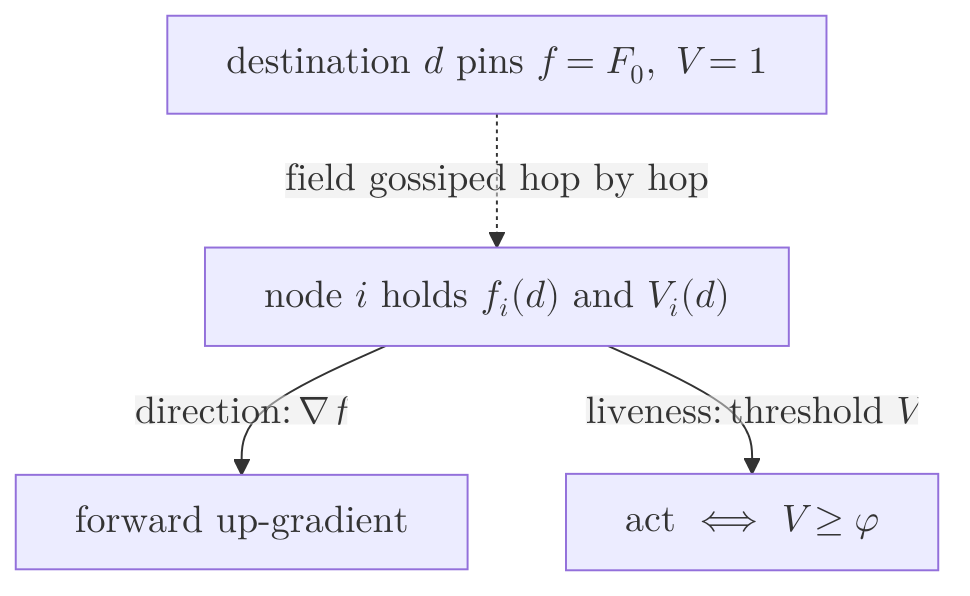
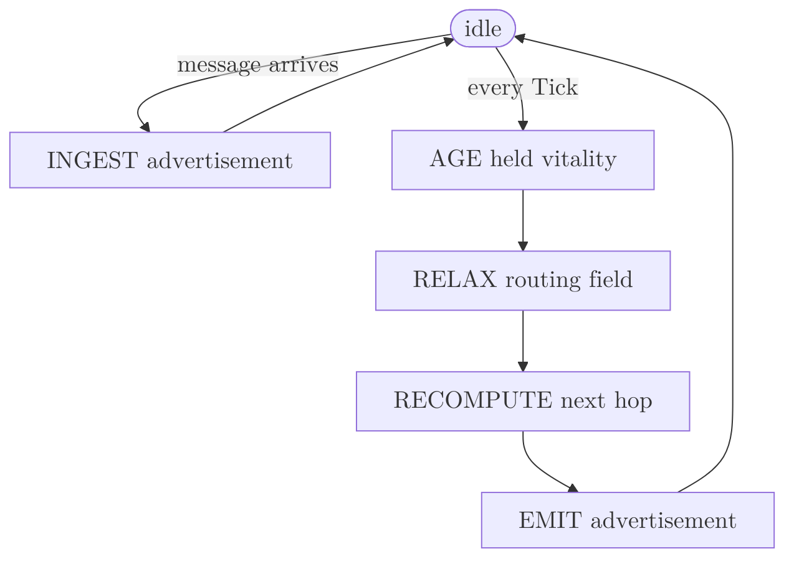
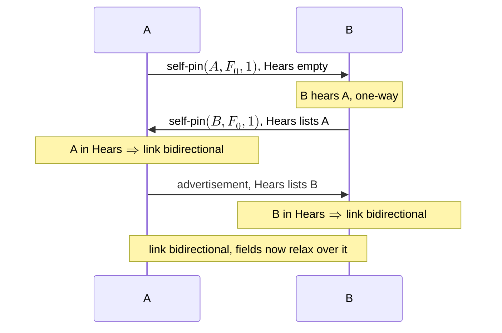
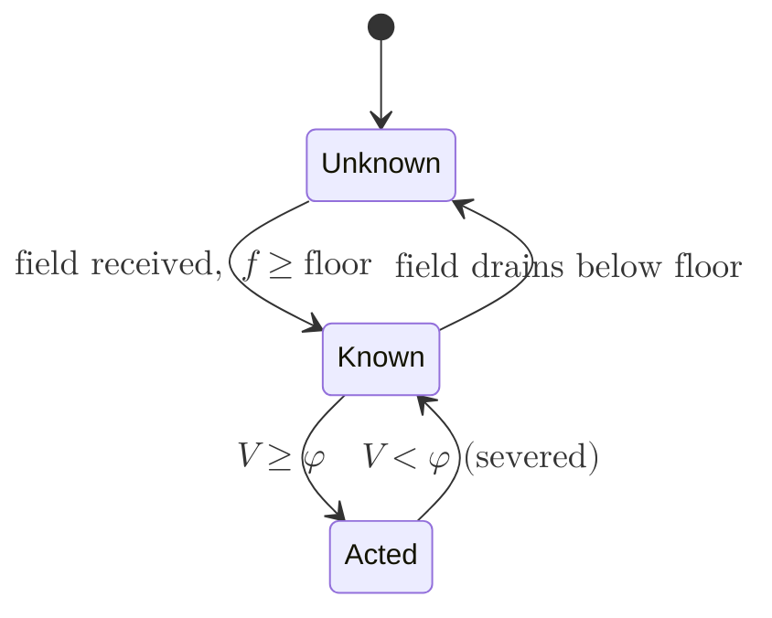
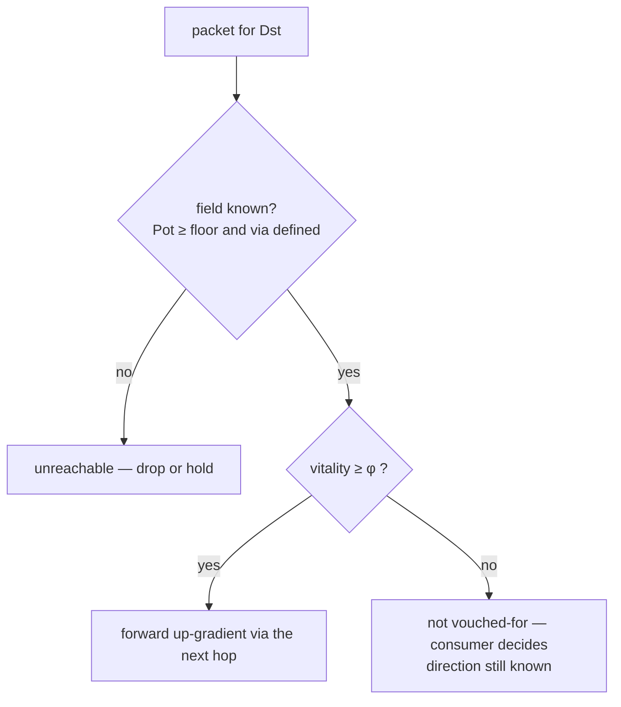

# RING Protocol Specification

*Operational / wire-level companion to the field theory in `ring.md` and the spec in `physics.md`.*

This document specifies what a RING node sends, receives, and computes — the message format, the relaxation cycle, the timing model, and the precise sense in which the protocol is *timer-free* and *clock-free*. The mathematics and proofs (why the fields behave as they do) live in `ring.md`; this document is the engineering contract.

---

## 1. Scope and overview

A RING node maintains, **for each destination it has heard of**, two transported scalar quantities:

- a **routing potential** $f$ (the `Pot` field): a screened-diffusion potential, highest at the destination, that a packet follows *up*-gradient; and
- a **vitality** $V\in[0,1]$ (the `Vit` field): confidence that the destination is alive, which droops with distance and decays when the destination falls silent.

Direction comes from the gradient of $f$; liveness comes from thresholding $V$.

Each node runs an independent loop: it **receives** advertisements from its neighbours, **relaxes** its two fields one step, and **emits** its own advertisement. There is no global clock, no synchronized round, no leader, and no per-route timer. A dead destination's potential drains and its vitality decays to zero on their own — there is nothing to expire.

This specification describes the **base, clock-free protocol**. A clock-synchronized deployment MAY use the optional refinement of §11; it is never required.

## 2. Terminology

- **Node** — a protocol instance with a stable identifier $\mathrm{id}$.
- **Link / neighbour** — a bidirectional adjacency over which two nodes exchange messages. A node treats a neighbour as *usable* only once the neighbour echoes hearing it (the 2-way handshake, §7).
- **Destination** — any node that appears as a destination in a received advertisement. A node keeps routing state per destination.
- **Tick** — the protocol's **proper-time quantum**, a chosen duration (reference: a few milliseconds). It is *both* the unit in which vitality aging and per-hop staleness are counted *and* the nominal period at which a node emits. A Tick is a **cadence**, not a timeout: nothing fails when one elapses.
- **Local clock** — each node's own monotonic clock. Nodes are **not** assumed synchronized; a node uses its clock only to measure *its own* elapsed durations and never compares it against another node's (§10–§11).
- **Relaxation cycle** — one iteration of *receive → age → relax → emit* (§6).
- **Aging rate** $\alpha$ — the rate at which vitality decays per Tick of proper time (§9).
- **Screening** $\kappa$ — sets the routing field's reach, $\lambda=\sqrt{D/\kappa}$ (§8).
- **Threshold** $\varphi$ — the vitality a consumer requires before acting on a route (§13).

## 3. Node state

A node holds, all private:

- **Adjacency table** — per neighbour $p$: $p$'s last-advertised potential toward each destination; whether $p$ currently echoes hearing us ($\mathrm{hears}$); and when we last heard from $p$.
- **Routing information base (RIB)** — per destination $d$: the potential $f^d$, the vitality $V^d$, the dominant next hop $\mathrm{via}^d$, and the local time $V^d$ was last aged.

No node state is shared between nodes; only **messages** cross between them.

## 4. Message format

A node emits exactly one message type.

**Message** — one multicast emission to all of a node's neighbours:

| field | type | meaning |
|---|---|---|
| $\mathrm{From}$ | id | the emitter |
| $\mathrm{Hears}$ | list of id | the neighbours the emitter currently hears — the 2-way adjacency echo |
| $\mathrm{Delta}$ | list of Entry | one entry per advertised destination |

**Entry** — one advertised destination:

| field | type | meaning |
|---|---|---|
| $\mathrm{Dest}$ | id | the destination this entry describes |
| $\mathrm{Pot}$ | real $\ge 0$ | the emitter's routing potential $f$ toward $\mathrm{Dest}$ |
| $\mathrm{Vit}$ | real $\in[0,1]$ | the emitter's vitality $V$ toward $\mathrm{Dest}$ |

That is the **entire** wire vocabulary: a sender, the neighbours it hears, and a list of $(\text{destination},\,\text{potential},\,\text{vitality})$ triples. There is no sequence number, no metric version, no hop count, no age field, **and in the base protocol no timestamp.** (The optional refinement of §11 adds one emission timestamp per message; the base protocol neither sends nor reads it.)

Every emission begins with the node's **self-pin** — the entry $(\mathrm{Dest}=\text{self},\ \mathrm{Pot}=F_0,\ \mathrm{Vit}=1)$ — which is how a node asserts *"I am here and alive."* A live destination re-asserts its self-pin every Tick; a dead node simply stops.

## 5. Reception

On receiving a message from neighbour $p$, a node:

1. records that $p$ was heard now, and sets $p$'s $\mathrm{hears}$ flag according to whether $\mathrm{Hears}$ contains this node's id (the bidirectional check);
2. for each entry whose $\mathrm{Dest}=d$ is not this node:
   - stores $p$'s advertised potential toward $d$ (used by the next relaxation, §6);
   - ages this node's existing $V^d$ toward zero by its own elapsed local time (§9), then performs the **retarded adopt-max**
     $$
     V^d \;\leftarrow\; \max\!\Big(V^d,\ \operatorname{age}\!\big(\mathrm{Vit},\,\tau\big)\Big),
     $$
     where $\tau$ is the staleness of the received value — **one Tick per relay** in the base protocol (§9).

Reception never emits; it only updates state.

## 6. The relaxation cycle

Independently, on its own cadence (nominally every Tick), a node performs one relaxation-and-emit. Receipt and the cadence are the node's two event sources:

The relaxation step (the cadence branch) is:

1. **Age.** Advance every $V^d$ toward zero by the local time elapsed since it was last aged (§9).
2. **Relax the routing field.** For each known destination $d$ (other than self), recompute the screened balance over the bidirectional neighbours $N^{\leftrightarrow}(i)$ (§7):
   $$
   f^d_i \;\leftarrow\; \frac{\displaystyle\sum_{p\,\in\,N^{\leftrightarrow}(i)} D\,f^d_p}{D\,\bigl|N^{\leftrightarrow}(i)\bigr| + \kappa}.
   $$
   The self field stays pinned at $F_0$. This is one Jacobi sweep of the screened-Poisson operator.
3. **Recompute the next hop.** Among bidirectional neighbours strictly uphill of $f^d_i$, choose the one of maximum up-gradient current $J^d_{ip}=D\,(f^d_p-f^d_i)$:
   $$
   \mathrm{via}^d \;=\; \operatorname*{arg\,max}_{p\,:\,f^d_p>f^d_i} \; J^d_{ip}.
   $$
   If no neighbour is uphill, $\mathrm{via}^d$ is empty (a transient local minimum; the node holds).
4. **Emit.** Build the message: the self-pin, plus an entry $(\,d,\ f^d_i,\ V^d_i\,)$ for every destination whose potential is at or above the floor and whose $\mathrm{via}^d$ is defined. Set $\mathrm{Hears}$ to the neighbours heard within the freshness window. Multicast to every neighbour.

## 7. Adjacency

Adjacency is established by the **self-pin / Hears handshake**:

A neighbour contributes to the field relaxation and is a forwarding candidate **only while bidirectional and heard within the freshness window $\mathrm{Fresh}$** (a small number of Ticks). This freshness window is the *one* place a staleness threshold appears, and it is confined to the **link layer** — it answers "is this adjacency still up?", not "is this route or destination still good?" The routing and liveness layers above it are timer-free (§10).

## 8. The routing field

$f$ is a screened-diffusion potential: pinned at $F_0$ at each destination and, everywhere else, relaxed to the conductance-weighted average of neighbours attenuated by $\kappa$ (step 2 above). At the fixed point the field satisfies the screened-Poisson balance $(\mathcal{L}+\kappa I)f=0$ away from the pin, from which (`ring.md` §5):

- the field's only maxima are the pinned destinations, so following it up-gradient **cannot loop or black-hole**;
- reach is a length $\lambda=\sqrt{D/\kappa}$: the field decays smoothly with distance and falls below the floor far from the destination, which bounds how many destinations a node tracks;
- a node under load MAY raise a local screening term (congestion), which flattens its potential and steers traffic around it without weakening any guarantee.

## 9. The vitality field (clock-free)

$V$ measures liveness as a continuously-decaying confidence, transported from the destination.

**Assertion.** A live destination emits $\mathrm{Vit}=1$ in its self-pin every Tick.

**Aging.** A node ages its held vitality toward zero by *its own* elapsed local time, by the exact continuous law
$$
V \;\leftarrow\; \frac{V}{1 + \alpha\,\Delta\,V},
$$
where $\Delta$ is the elapsed time in Ticks. This is the proper-time flow $\dot V=-\alpha V^2$, whose value at integer age $k$ from $V=1$ is the Lorentzian
$$
V(k) \;=\; \frac{1}{1+\alpha k}.
$$

**Retardation (clock-free).** A received vitality is evidence emitted some transit ago, so it is aged by that staleness *before* being adopted. In the base protocol the staleness is taken as **one Tick per relay**, $\tau=1$ — a fixed duration, requiring no timestamp and no cross-node clock comparison. The retardation is what stops a dead destination from being held alive by neighbours reflecting stale vitality at one another (`ring.md` Theorem 6.2): aging the offered value by at least its true transit makes the adopted value no fresher than the node's own, so the field can only decay.

**Combination.** A node keeps the maximum over its ports of the aged offered vitalities and its own aged value — *any sufficiently-fresh path keeps it alive.*

At convergence to a live destination, vitality droops with hop distance,
$$
V^d(\delta)\;\approx\;\frac{1}{1+\alpha\,\delta}
$$
(plus a little extra from relay dwell — honest staleness, since the value really did sit at each node).

A **route's lifecycle** in the RIB is exactly the crossing of two levels — the field floor and the vitality threshold $\varphi$:

When a destination dies it stops asserting $\mathrm{Vit}=1$; every held value ages to zero with nothing to refresh it, and a consumer **severs** the route when $V$ falls below $\varphi$ — a continuous decay crossing a level, not a timer firing.

## 10. Timer-free operation

"Timer-free" has a precise meaning here. RING has **none** of the timers a distance-vector or link-state protocol relies on:

- no **route-expiry / garbage-collection timer** — a dead route's potential drains and its vitality decays on their own;
- no **hold-down timer** — there is no count-to-infinity to suppress (the field is bounded by its pin), so nothing must be frozen;
- no **dead-interval / failure-detection timeout** — liveness is the continuous vitality field, severed by a *threshold crossing*, not by "no message for $T$ seconds";
- no **sequence numbers or tombstones** — there is no versioned state to expire or to suppress resurrection of.

The only time-derived quantities are (a) the **proper-time aging** of vitality, which is continuous and measured in each node's own frame, and (b) the **emission cadence** (a node re-advertises about every Tick), which is a refresh rate, not a deadline. The single staleness *window* in the protocol is the link-layer freshness check of §7, governing adjacency alone.

## 11. No shared clock

RING assumes **no clock synchronization** between nodes — and this *simplifies* the protocol rather than complicating it:

- A node ages its held vitality using only *its own* clock, measuring *its own* elapsed durations. A clock offset (skew) cancels in any single node's own time differences, so held-aging is skew-immune. - The retardation uses a **fixed one-Tick-per-relay** staleness — a duration, not a cross-node timestamp comparison — so it too is immune to clock offset, and tolerant of clock drift up to the margin by which a Tick exceeds the real per-hop delay.

A protocol that instead measured one-way transit by comparing a sender's emission timestamp against the receiver's clock would **require** synchronized clocks: under unsynchronized clocks the measured transit is corrupted by the skew difference, which either over-ages a live destination's vitality below threshold (false death) or under-ages it (resurrection). The base protocol avoids the problem by never comparing clocks across nodes.

**Optional refinement (clock-synced deployments).** Where nodes *do* share a synchronized clock (NTP / PTP), a message MAY carry its emission timestamp $\mathrm{Emit}$, and a receiver MAY age a received vitality by the *measured* transit $\tau=(\text{now}-\mathrm{Emit})/\mathrm{Tick}$ instead of a fixed Tick. This recovers the exact proper-time law
$$
V^d_i \;=\; \frac{1}{1+\alpha\,T}, \qquad T=\text{least accumulated transit from } d \text{ to } i,
$$
rather than the hop-count approximation $T\approx\delta$. It is an optimization for environments that already pay for clock sync; the base protocol does not need it.

## 12. Concurrency model

Each node executes independently: it interleaves *reception* (whenever a message arrives) with the *relaxation cycle* (on its own Tick cadence), and it shares no state with any other node — only messages cross link boundaries. There is no global tick, no barrier, no leader, and no lock-step; nodes may run at different rates and their cadences need not align. Message delivery is best-effort: a lost or reordered advertisement is simply superseded by the next emission, since each message carries the sender's *current* fields, not a delta against history.

## 13. Forwarding (data plane)

To forward a packet toward a destination, a node consults its RIB:

Formally, a destination is **routable** iff it is *known* and its vitality clears the consumer's threshold:
$$
\text{routable} \;\equiv\; \underbrace{\bigl(f^d_i\ge\text{floor}\ \wedge\ \mathrm{via}^d\neq\varnothing\bigr)}_{\text{known}}\ \wedge\ \bigl(V^d_i\ge\varphi\bigr).
$$
The next hop is $\mathrm{via}^d$ (the dominant up-gradient current); a node MAY also spread across all up-gradient neighbours in proportion to their current $J^d_{ip}$ for multipath. A vitality below $\varphi$ does **not** erase the direction — it reports that the destination's liveness is no longer vouched for. Whether to attempt delivery anyway is the consumer's decision; severance is a policy threshold, not a substrate deletion.

## 14. Parameters

| symbol | meaning | reference |
|---|---|---|
| $\mathrm{Tick}$ | proper-time quantum and nominal emission period | a few ms; MUST be $\ge$ the max per-hop delay |
| $\alpha$ | vitality aging rate per Tick | $0.04$ (vitality horizon $\approx 1/\alpha \approx 25$ hops) |
| $\varphi$ | vitality action threshold | $0.5$ |
| $\kappa$ | screening; reach $\lambda=\sqrt{D/\kappa}$ | $0.05$ |
| $D$ | bulk conductance | $1$ |
| $F_0$ | source self-pin | $1$ |
| floor | reachability floor on the field | $10^{-4}$ |
| $\mathrm{Fresh}$ | link-layer freshness window, in Ticks | ${\sim}8$ |

$\mathrm{Tick}\ge$ max per-hop delay is the one timing constraint: it keeps the one-Tick-per-relay retardation a safe (non-under-counting) estimate of staleness. Everything else is a reach / decay / threshold trade.

## 15. Worked example

A four-node line $n_0 - n_1 - n_2 - n_3$, clock-free, after convergence. Each node emits its self-pin plus an entry per routable destination. An example converged set of advertisements:

| emitter | self-pin | toward $n_3$ | toward $n_2$ | toward $n_1$ | toward $n_0$ |
|---|---|---|---|---|---|
| $n_3$ | $(n_3,\,1.000,\,1.000)$ | — | $(0.952,\,0.961)$ | $(0.465,\,0.891)$ | $(0.227,\,0.829)$ |
| $n_2$ | $(n_2,\,1.000,\,1.000)$ | $(0.714,\,0.962)$ | — | $(0.488,\,0.962)$ | $(0.238,\,0.891)$ |
| $n_0$ | $(n_0,\,1.000,\,1.000)$ | $(0.442,\,0.860)$ | $(0.465,\,0.926)$ | $(0.952,\,0.962)$ | — |

Reading $n_0$'s view of the far endpoint $n_3$ (three hops away): $\mathrm{Pot}=0.442$ — the screened field has decayed with distance but stays well above the floor, so $n_3$ is *known* — and $\mathrm{Vit}=0.860$ — vitality has drooped over three relays, $\approx 1/(1+\alpha\delta)$ with a little dwell, and stays above $\varphi=0.5$, so the route is *acted on*. To forward toward $n_3$, $n_0$ follows its $\mathrm{via}$ up the potential gradient.

Now suppose $n_3$ dies. It stops emitting; $n_2$ stops hearing it. With nothing re-asserting $\mathrm{Vit}=1$, every node's vitality toward $n_3$ ages toward zero — and because each relay's retardation makes adopted values no fresher than its own, the chain cannot hold the ghost up. When $n_0$'s vitality toward $n_3$ crosses below $\varphi$, $n_0$ severs the route. No timer fired; a continuously-decaying field crossed a threshold.
